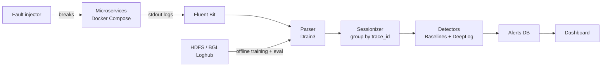

# Log Anomaly Detection for Microservices — Project Hub

Working name: **LogPulse** (rename freely). This is the 5th-sem AIML team project — the log-detection project, separate from SentinelDB.

## Table of Contents

- [[#One-line pitch|One-line pitch]]
- [[#The problem|The problem]]
- [[#What we are building|What we are building]]
- [[#Objectives|Objectives]]
- [[#What makes it more than a tutorial|What makes it more than a tutorial]]
- [[#Headline results we will report|Headline results we will report]]
- [[#What is required — at a glance|What is required — at a glance]]
- [[#Notes in this folder|Notes in this folder]]
- [[#Decisions still open|Decisions still open]]

## One-line pitch

A pipeline that reads raw logs from a set of running microservices, turns each line into a structured "event template" (Drain), groups events by request (trace ID), and flags request flows that look abnormal — using classical ML baselines and a DeepLog-style LSTM — evaluated on the standard HDFS and BGL benchmarks and shown live on a demo system with injected faults.

## The problem

A microservice system with 10 services can produce millions of log lines a day. When something breaks — a payment service timing out, a database connection pool filling up — the evidence is in the logs, but no human reads them in real time. Rule-based alerts (`grep ERROR`) miss failures that never print the word "ERROR" (a request that silently skips a step, a retry loop, an out-of-order sequence). We want a system that learns what **normal log behaviour** looks like and raises an alert when the behaviour deviates.

## What we are building

Two tracks run in parallel:

1. **Offline research track** — HDFS + BGL from Loghub → parse → build sequences → train/compare models → results table. This is what goes in the report/paper.
2. **Live systems track** — a small microservice app → collect logs → same parser + model running online → inject faults → show detection on a dashboard. This is what wins the demo.

Full detail: [[02 - System Architecture]].

## Objectives

1. Parse unstructured logs into event templates with Drain and measure parsing accuracy on Loghub's labelled samples.
2. Build session/window-based event sequences for HDFS (block ID), BGL (time/count windows) and the demo app (trace ID).
3. Train and compare classical ML models (Logistic Regression, Decision Tree, Naive Bayes, Random Forest, plus unsupervised PCA/Isolation Forest) on event-count features.
4. Implement a DeepLog-style LSTM that learns normal event order and flags deviations, trained on normal data only.
5. Evaluate honestly — precision, recall, F1 under a **chronological** split, and show how a random split inflates scores.
6. Deploy the pipeline against a live microservice app, inject faults, and measure detection latency and false-alarm rate.
7. Improve on vanilla DeepLog with a semantic template matcher (fewer false alarms after deployments), an adaptive top-p decision rule (better F1) and step-wise online scoring (faster detection) — each measured against the conventional approach.
8. Make every alert visual and traceable — topology map, event views, expected-vs-observed explanation, raw evidence, and a ground-truth verdict.

## What makes it more than a tutorial

- **Trace ID = block ID.** HDFS works so well for log anomaly detection because every line carries a `blk_` ID that ties a session together. We recreate that in microservices by propagating a `trace_id` across services — so the same techniques transfer to a modern architecture.
- **Honest evaluation.** The ICSE 2022 study *"Log-based Anomaly Detection with Deep Learning: How Far Are We?"* showed DeepLog's BGL F1 drops from 0.927 with a random split to 0.426 with a chronological split. We reproduce that effect ourselves instead of quoting inflated numbers. See [[07 - Evaluation Plan]].
- **Classical vs deep, same data.** A fair, side-by-side comparison on identical splits is genuinely useful and syllabus-aligned.
- **Closed loop demo.** Fault in → alert out, with a measured time-to-detect.
- **Our own improvements, with numbers.** Three changes on top of DeepLog, each tied to one metric beaten against the conventional method — see [[15 - Our Improvements]]:
  - Semantic template matcher → **false alarms after a deploy ↓** (signature contribution)
  - Adaptive top-p detection → **F1 on BGL ↑** vs fixed top-g
  - Step-wise online scoring → **mean time to detect ↓** vs threshold alerts
- **Beats conventional monitoring where it matters.** Keyword alerts, error-rate thresholds and health checks run side by side with our model; silent faults (no ERROR line) are where they fail — see [[14 - Metrics and Baselines]].
- **Fully visual and traceable.** Every alert drills down to raw log lines and is checked against the fault ground truth — see [[13 - Demo Visualization and Traceability]].

## Headline results we will report

| Metric | Compared against | Direction |
|---|---|---|
| Fault detection rate (esp. silent faults) | Keyword / error-rate / health-check alerts | ↑ |
| Median time to detect | Same | ↓ |
| False alarms per hour after a deployment | Vanilla DeepLog | ↓ |
| Lines a human must read per incident | Raw logs in the fault window | ↓ |
| F1 on BGL (chronological split) | Vanilla DeepLog top-g + classical models | ↑ |

Numbers get filled only from measured runs — see [[14 - Metrics and Baselines#Credibility rules|credibility rules]].

## What is required — at a glance

| Category | What | Note |
|---|---|---|
| Knowledge | Python + pandas, scikit-learn, basic PyTorch + LSTM, Docker Compose, regex | [[10 - Learning Plan and Resources]] |
| Datasets | Loghub HDFS_v1, BGL, Loghub-2k labelled samples | [[03 - Datasets]] |
| Software | Python 3.11, drain3, scikit-learn, PyTorch, FastAPI, Streamlit, Docker, Fluent Bit | [[08 - Tech Stack and Repo Structure]] |
| Hardware | Any laptop with 8 GB+ RAM (16 GB comfortable); Colab GPU optional | HDFS raw is ~1.5 GB, so process in chunks |
| Deliverables | Synopsis, code repo, results table, live demo, final report, (optional) paper | [[11 - Report and Synopsis Content]] |
| Reviews | Demo script + viva answers | [[12 - Demo and Viva Prep]] |

## Notes in this folder

- [[01 - Concepts Explained Simply]] — logs, templates, sessions, anomalies, LSTM, in plain English
- [[02 - System Architecture]] — components, data flow, interfaces
- [[03 - Datasets]] — HDFS, BGL, Loghub-2k, demo-app data, labelling
- [[04 - Log Parsing with Drain]] — the algorithm with a dry run, Drain3 config
- [[05 - Models]] — classical baselines + DeepLog, with a dry run
- [[06 - Microservices Demo Setup]] — demo app, trace IDs, Fluent Bit, fault injection
- [[07 - Evaluation Plan]] — metrics, splits, experiments, results-table templates
- [[08 - Tech Stack and Repo Structure]] — tools, folders, configs
- [[09 - Roadmap and Team Split]] — 10-week milestone plan, who does what
- [[10 - Learning Plan and Resources]] — what to study and in what order
- [[11 - Report and Synopsis Content]] — abstract, objectives, literature survey, methodology text
- [[12 - Demo and Viva Prep]] — demo script and likely questions
- [[13 - Demo Visualization and Traceability]] — dashboard panels, alert drill-down, traceability chain
- [[14 - Metrics and Baselines]] — conventional baselines, headline metrics, measurement protocol
- [[15 - Our Improvements]] — semantic template matcher, adaptive top-p, step-wise scoring
- [[16 - Fault Catalogue Explained]] — F1–F7: what breaks, how it is injected, what the logs show, who catches it
- [[17 - How to Run]] — step-by-step commands: setup, 10-minute demo, dashboard, faults, benchmarks, training, troubleshooting
- [[18 - What Does What]] — containers, the life of one log line, the nine detectors, every file in the repo

## Decisions still open

- [ ] Team size and who owns which track (see [[09 - Roadmap and Team Split]]).
- [ ] Confirm with the guide that an LSTM (DeepLog) is acceptable — the AI/ML course (IS353IA) is classical-ML only, so the classical baselines are the syllabus-mapped core and DeepLog is the "beyond syllabus" contribution.
- [ ] Demo app: write our own 4–5 small services (recommended) or use an existing benchmark (Google Online Boutique / TrainTicket).
- [ ] Kafka in the pipeline or not (recommended: not for MVP).
- [ ] Review dates for the EL phases — map the milestones in [[09 - Roadmap and Team Split]] onto them.
