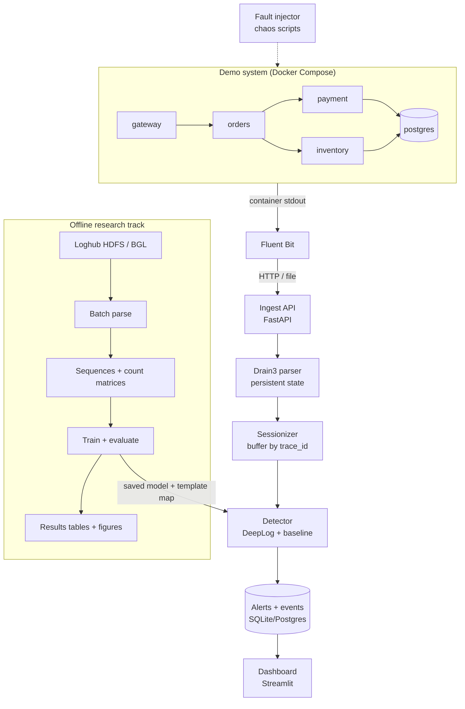

# System Architecture

Related: [[00 - Project Hub]] · [[06 - Microservices Demo Setup]] · [[08 - Tech Stack and Repo Structure]]

## Table of Contents

- [[#Big picture|Big picture]]
- [[#Component by component|Component by component]]
- [[#Offline pipeline|Offline pipeline]]
- [[#Online pipeline|Online pipeline]]
- [[#Data contracts between components|Data contracts between components]]
- [[#MVP vs stretch architecture|MVP vs stretch architecture]]
- [[#Design decisions and why|Design decisions and why]]

## Big picture



## Component by component

| # | Component | Job | Input → Output | Tech |
|---|---|---|---|---|
| 1 | Demo microservices | Generate realistic logs with trace IDs | HTTP requests → JSON log lines on stdout | FastAPI (Python) or Express (Node), Docker |
| 2 | Load generator | Produce steady "normal" traffic | script → requests | Locust or a simple `httpx` loop |
| 3 | Fault injector | Break things on purpose, record when | schedule → faults + ground-truth file | Bash/Python, `docker kill/pause`, Toxiproxy or `tc netem`, env flags |
| 4 | Log shipper | Collect logs from all containers | container stdout → HTTP POST batches | Fluent Bit |
| 5 | Ingest API | Receive batches, hand to parser | JSON lines → queue | FastAPI |
| 6 | Parser | Line → template ID + parameters | raw message → `event_id` | drain3 with masking + file persistence |
| 7 | Sessionizer | Group events per trace, close sessions on timeout | event stream → completed sessions | Python dict + expiry timer |
| 8 | Detector | Score each session | sequence → `is_anomaly`, score, offending step | PyTorch (DeepLog), scikit-learn (baseline) |
| 9 | Store | Keep events, sessions, alerts | rows | SQLite (MVP) → Postgres |
| 10 | Dashboard | Show live stream, alerts, metrics | DB → charts | Streamlit (+ optional Grafana) |
| 11 | Template matcher | Map unseen templates to nearest known one | new template → `matched_to`, score | scikit-learn TF-IDF ([[15 - Our Improvements]]) |
| 12 | Baseline detectors | Keyword, error-rate threshold, health check — run alongside the model | stream → `baseline_alerts` | Python ([[14 - Metrics and Baselines]]) |
| 13 | Scorer | Match alerts to fault ground truth → TP/FP/FN, TTD | alerts + ground truth → metrics | Python, `scripts/score_live.py` |

Panel-by-panel dashboard design and the traceability chain: [[13 - Demo Visualization and Traceability]].

## Offline pipeline

1. **Load** raw HDFS/BGL logs in chunks (pandas `read_csv(chunksize=…)` or line iteration — HDFS is ~11 M lines).
2. **Parse** each line with Drain3 → `structured.csv` (`LineId, Timestamp, Component, Content, EventId, EventTemplate`) + `templates.csv`.
3. **Group**
   - HDFS: extract `blk_-?\d+` from each line → session per block ID, label from `anomaly_label.csv`.
   - BGL: fixed windows (e.g. 20 / 100 lines) or time windows; window is anomalous if any line has a non-`-` label.
4. **Split chronologically** — sort sessions by first timestamp; first 80% train, last 20% test (and carve a validation slice from train).
5. **Featurize**
   - Count matrix (sessions × templates) for classical models, optionally TF-IDF weighted.
   - Event-ID sequences + sliding windows of length `h` for DeepLog.
6. **Train + evaluate** every model on the same split → `reports/results.csv` + figures.
7. **Export** the chosen model, the template→ID map and thresholds for the online detector.

## Online pipeline

1. Every service logs one JSON object per line: `{"ts", "level", "service", "trace_id", "msg"}`.
2. Fluent Bit tails the Docker logs and POSTs batches to `/ingest`.
3. The parser runs `template_miner.add_log_message(msg)`; new templates get a new ID (and are flagged as *unseen*).
4. The sessionizer appends `(ts, service, event_id)` to `sessions[trace_id]`. A session closes when no new line arrives for N seconds (e.g. 5 s) or a terminal event appears.
5. On close → detector scores it → result written to the store. DeepLog can also score **step by step** while the session is still open, which lowers detection latency.
6. Dashboard polls the store every 1–2 s.

## Data contracts between components

Raw log line (service → shipper):

```json
{"ts": "2026-10-22T10:15:02.114Z", "level": "INFO", "service": "orders",
 "trace_id": "a91f3c", "msg": "Created order 5521 for user 88"}
```

Parsed event (parser → sessionizer):

```json
{"ts": "...", "service": "orders", "trace_id": "a91f3c",
 "event_id": 3, "template": "Created order <*> for user <*>", "unseen": false}
```

Detection result (detector → store):

```json
{"trace_id": "a91f3c", "n_events": 9, "model": "deeplog",
 "is_anomaly": true, "score": 0.83, "first_bad_step": 6,
 "expected_top": [4, 7, 2], "actual": 11, "detected_at": "..."}
```

`first_bad_step` + `expected_top` vs `actual` is what makes alerts explainable on the dashboard: *"after `Charging card…`, we expected `Payment confirmed`, but saw `Gateway timeout`."*

## MVP vs stretch architecture

**MVP (enough for a complete project)**
- 4 services + Postgres in Docker Compose, trace IDs, JSON logs.
- Fluent Bit → FastAPI ingest → Drain3 → sessionizer → DeepLog + one baseline → SQLite → Streamlit.
- Offline results on HDFS (+ BGL).

**Stretch 1**
- Kafka (or Redpanda) between Fluent Bit and the parser, so components can restart independently.
- Online step-wise DeepLog scoring for lower latency.
- Model retraining/feedback button: mark a false alarm → add that session to normal training data.

**Stretch 2**
- Move the demo onto Kubernetes (minikube/kind) and inject faults with Chaos Mesh or LitmusChaos — directly overlaps with the open-source/CNCF plan.
- Prometheus metrics (lines/sec, alerts/min) + Grafana panel.
- Per-service root-cause hint: which service's event caused the first deviation.

## Design decisions and why

| Decision | Choice | Why |
|---|---|---|
| Parser | Drain (Drain3) | Online, fast, top accuracy in the Loghub parser benchmark, maintained Python package |
| Session key | `trace_id` | Mirrors HDFS `block_id`; without it, interleaved requests are impossible to separate |
| Main model | DeepLog-style LSTM | Needs only normal data; captures order; well-known baseline, easy to explain |
| Baselines | LR, DT, NB, RF, PCA, Isolation Forest | Syllabus-aligned, fast, strong on HDFS — keeps the deep model honest |
| Transport | HTTP batches (MVP) | Fewer moving parts; Kafka only if time allows |
| Store | SQLite → Postgres | Zero setup first; Postgres already in the demo stack |
| UI | Streamlit | A live dashboard in ~150 lines of Python; React only if someone wants frontend practice |
