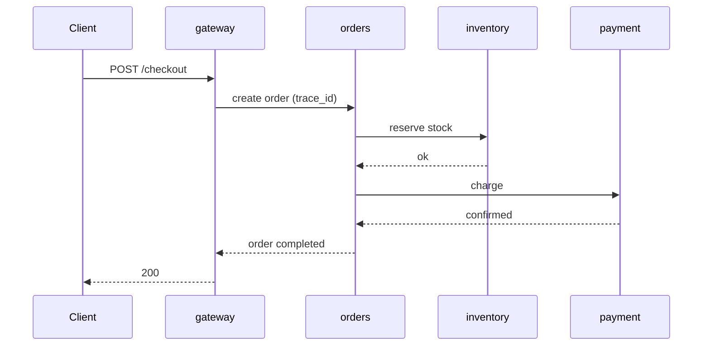

# Microservices Demo Setup

Related: [[00 - Project Hub]] · [[02 - System Architecture]] · [[03 - Datasets]]

## Table of Contents

- [[#Goal|Goal]]
- [[#Option A vs Option B|Option A vs Option B]]
- [[#The demo services|The demo services]]
- [[#Logging rules every service follows|Logging rules every service follows]]
- [[#Trace ID propagation|Trace ID propagation]]
- [[#Docker Compose skeleton|Docker Compose skeleton]]
- [[#Fluent Bit config|Fluent Bit config]]
- [[#Load generator|Load generator]]
- [[#Fault injection catalogue|Fault injection catalogue]]
- [[#Kubernetes version (stretch)|Kubernetes version (stretch)]]
- [[#Checklist|Checklist]]

## Goal

A small but realistic system that (1) produces logs with request-level trace IDs, (2) can be broken in controlled, recorded ways, and (3) runs on a laptop with `docker compose up`.

## Option A vs Option B

| | **A. Our own 4–5 services (recommended)** | B. Existing benchmark (Online Boutique / TrainTicket) |
|---|---|---|
| Effort | ~1 week | Setup is quick, understanding logs is slow |
| Log quality | We decide format + trace IDs | Mixed formats, tracing needs extra setup |
| Fault control | Built-in env-flag faults | External chaos tools only |
| RAM | < 2 GB | Online Boutique ~4 GB+, TrainTicket much more |
| Report story | "Designed for observability" | "Real-world benchmark system" |

Go with **A** for the MVP. If time is left, show the same pipeline on Online Boutique as a generalisation experiment.

## The demo services

A tiny e-commerce flow — easy to explain to judges:



| Service | Endpoints | Logs it writes (→ templates) |
|---|---|---|
| gateway | `POST /checkout`, `GET /health` | request received, auth ok/failed, response sent with status |
| orders | `POST /orders` | order created, calling inventory, calling payment, order completed/failed |
| inventory | `POST /reserve`, `POST /release` | stock reserved, insufficient stock, stock released |
| payment | `POST /charge` | charging, confirmed, declined, timeout, retry n |
| postgres | — | (optional) include its logs too |

Each service: FastAPI + `httpx` + `structlog` or the standard `logging` module with a JSON formatter. ~100–150 lines each.

## Logging rules every service follows

1. One JSON object per line on **stdout** (Docker captures it).
2. Fields: `ts` (ISO-8601 UTC), `level`, `service`, `trace_id`, `msg`.
3. `msg` is a stable sentence with variables inside — `f"Charging card for order {oid} amount {amt}"` — never build messages that change shape.
4. Log at every meaningful step (entry, outbound call, outcome), not only errors. The model learns from INFO lines.
5. Retries and fallbacks are logged explicitly ("Retrying payment attempt 2").

## Trace ID propagation

```python
import uuid, contextvars
from fastapi import FastAPI, Request

trace_var = contextvars.ContextVar("trace_id", default="-")
app = FastAPI()

@app.middleware("http")
async def trace_mw(request: Request, call_next):
    tid = request.headers.get("X-Trace-Id") or uuid.uuid4().hex[:12]
    trace_var.set(tid)
    response = await call_next(request)
    response.headers["X-Trace-Id"] = tid
    return response

# on every outbound call:
# httpx.post(url, json=..., headers={"X-Trace-Id": trace_var.get()})
# and add trace_var.get() to every log record via a logging.Filter
```

The gateway creates the ID; every downstream call forwards the header. Optional upgrade: OpenTelemetry auto-instrumentation does this for you and also gives spans (nice CNCF tie-in), but the hand-rolled header is easier to explain.

## Docker Compose skeleton

`deploy/docker-compose.yml`:

```yaml
services:
  gateway:
    build: ../services/gateway
    ports: ["8000:8000"]
    environment: [ORDERS_URL=http://orders:8000]
    logging: &fluent
      driver: fluentd
      options:
        fluentd-address: localhost:24224
        tag: "svc.{{.Name}}"
  orders:
    build: ../services/orders
    environment: [INVENTORY_URL=http://inventory:8000, PAYMENT_URL=http://payment:8000]
    logging: *fluent
  inventory:
    build: ../services/inventory
    environment: [DB_URL=postgresql://app:app@db:5432/shop]
    logging: *fluent
  payment:
    build: ../services/payment
    environment: [FAULT_MODE=none]       # flipped by the fault injector
    logging: *fluent
  db:
    image: postgres:16
    environment: [POSTGRES_USER=app, POSTGRES_PASSWORD=app, POSTGRES_DB=shop]
  fluent-bit:
    image: fluent/fluent-bit:3.1
    ports: ["24224:24224"]
    volumes: ["./fluent-bit.conf:/fluent-bit/etc/fluent-bit.conf"]
  detector:
    build: ../src
    ports: ["9000:9000"]               # /ingest endpoint
  dashboard:
    build: ../dashboard
    ports: ["8501:8501"]
```

Note: with the `fluentd` logging driver, start `fluent-bit` first (`docker compose up -d fluent-bit`), or containers fail to start. Simpler alternative for MVP: default `json-file` driver + Fluent Bit `tail` input on `/var/lib/docker/containers/*/*.log` (works on Linux; on Windows/Docker Desktop the forward driver is easier).

## Fluent Bit config

`deploy/fluent-bit.conf`:

```ini
[SERVICE]
    Flush        1
    Log_Level    info

[INPUT]
    Name         forward
    Listen       0.0.0.0
    Port         24224

[FILTER]
    Name         parser
    Match        svc.*
    Key_Name     log
    Parser       json
    Reserve_Data On

[OUTPUT]
    Name         http
    Match        svc.*
    Host         detector
    Port         9000
    URI          /ingest
    Format       json

[OUTPUT]
    Name         file
    Match        svc.*
    Path         /data/raw_logs      # also keep a copy on disk = our dataset
```

(The `json` parser is defined in Fluent Bit's default `parsers.conf`; add `Parsers_File parsers.conf` under `[SERVICE]` if it isn't picked up.)

## Load generator

`scripts/load.py` — steady, varied, reproducible traffic:

```python
import httpx, random, time
random.seed(42)
ITEMS = ["pen", "book", "mug", "lamp"]
while True:
    body = {"user": random.randint(1, 500), "item": random.choice(ITEMS),
            "qty": random.randint(1, 3)}
    try:
        httpx.post("http://localhost:8000/checkout", json=body, timeout=5)
    except httpx.HTTPError:
        pass
    time.sleep(random.expovariate(20))   # ~20 req/s, Poisson arrivals (queueing-theory nod)
```

Include some *normal* variety: occasional declined cards, insufficient stock, a single retry — otherwise the model learns that every rare-but-normal path is an anomaly.

## Fault injection catalogue

`chaos/inject.py` runs a schedule and appends every fault to `chaos/ground_truth.csv`.

| ID | Fault | How | What the logs should show |
|---|---|---|---|
| F1 | Payment latency | `FAULT_MODE=slow` (sleep 3 s) or Toxiproxy latency | timeouts, retries, failed orders |
| F2 | Payment hard down | `docker stop payment` for 60–90 s | connection errors in orders |
| F3 | Inventory skipped (logic bug) | `FAULT_MODE=skip_reserve` in orders | order completed **without** "stock reserved" — no error line at all (ordering anomaly) |
| F4 | Retry storm | payment returns 503 for 50% of calls | many repeated retry events (count anomaly) |
| F5 | DB connection exhaustion | `ALTER SYSTEM SET max_connections` low / pause db | inventory errors, cascading failures |
| F6 | Container pause | `docker pause inventory` | hanging requests, gateway timeouts |
| F7 | Bad deploy | new log message text in one service | unseen templates → tests the unstable-log policy |

F3 and F4 are the important ones — they show why learning from sequences/counts beats keyword alerts.

## Kubernetes version (stretch)

Same images on `kind` or `minikube`; Fluent Bit as a DaemonSet (official Helm chart); faults via **Chaos Mesh** or **LitmusChaos** (`PodChaos`, `NetworkChaos`). This doubles as practice for the open-source/CNCF plan — LitmusChaos is one of the projects on the shortlist.

## Checklist

- [ ] Write the 4 services with JSON logging + trace-ID middleware.
- [ ] `docker compose up` works end to end; `curl /checkout` returns 200.
- [ ] Fluent Bit delivers lines to `/ingest` and to the file output.
- [ ] Load generator runs for 2 h without the system falling over.
- [ ] Implement F1–F4 first, then F5–F7.
- [ ] `ground_truth.csv` written automatically for every fault.
- [ ] Record the "normal" dataset (2–3 h) and the fault dataset.
