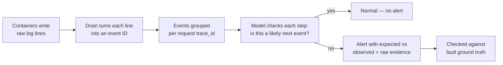
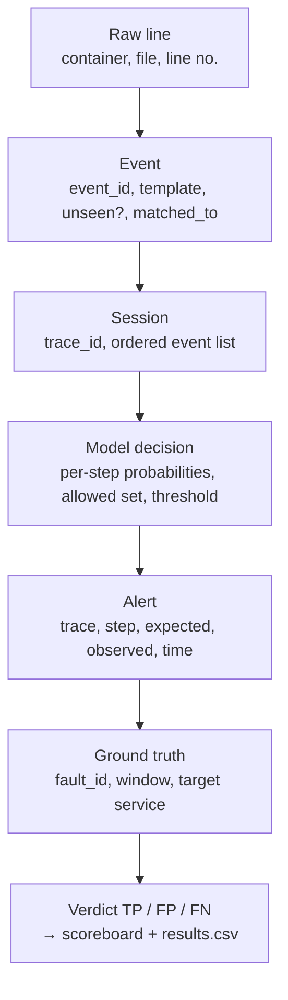

# Demo Visualization and Traceability

Related: [[00 - Project Hub]] · [[06 - Microservices Demo Setup]] · [[12 - Demo and Viva Prep]] · [[14 - Metrics and Baselines]]

The algorithm is only half the project. If nobody can *see* what the system is doing, the work doesn't land. This note designs the visual side so that every step — servers, logs, events, model reasoning, alerts, results — is on screen and every alert can be traced back to raw evidence.

## Table of Contents

- [[#Design principles|Design principles]]
- [[#What the model does — the story we are visualizing|What the model does — the story we are visualizing]]
- [[#Screen layout|Screen layout]]
- [[#Panel 1 — Live topology map|Panel 1 — Live topology map]]
- [[#Panel 2 — Log wall and event chips|Panel 2 — Log wall and event chips]]
- [[#Panel 3 — Untangling view|Panel 3 — Untangling view]]
- [[#Panel 4 — Template library|Panel 4 — Template library]]
- [[#Panel 5 — Normal flow graph|Panel 5 — Normal flow graph]]
- [[#Panel 6 — Alert panel and drill-down|Panel 6 — Alert panel and drill-down]]
- [[#Panel 7 — Fault control panel|Panel 7 — Fault control panel]]
- [[#Panel 8 — Scoreboard|Panel 8 — Scoreboard]]
- [[#Incident reports|Incident reports]]
- [[#The traceability chain|The traceability chain]]
- [[#Data each panel needs|Data each panel needs]]
- [[#Build plan|Build plan]]
- [[#Demo flow using these panels|Demo flow using these panels]]

## Design principles

1. **Show the system, not just the score.** The audience must see containers, traffic and logs before they see any model output.
2. **Every alert is explainable.** An alert without "what we expected vs what we saw" is not allowed on screen.
3. **Every alert is checkable.** Each alert is matched against the fault-injection ground truth and marked TP / FP; every missed fault is shown as FN.
4. **One click from summary to raw line.** Alert → sequence → model probabilities → raw log lines → container.
5. **Live but reproducible.** Everything shown live is also written to the store, so the same screens can be replayed from a recorded run if the live system misbehaves.

## What the model does — the story we are visualizing



In one sentence: *the model learned from healthy traffic which event normally follows which; for every live request it checks each step, and when an event is too unlikely it raises an alert that says exactly where the request went wrong and what should have happened instead.*

## Screen layout

One dashboard, two modes: **Live** (projector during the demo) and **Investigate** (drill-down on a clicked alert).

```text
┌──────────────────────────────────────────────┬──────────────────────────────┐
│ 1. Live topology map (containers + traffic)  │ 8. Scoreboard                │
│    gateway → orders → inventory / payment    │   TP  FP  FN · MTTD · FA/h   │
│    box colour = health, counters = lines/s   │   keyword alert vs model     │
├──────────────────────────────────────────────┼──────────────────────────────┤
│ 2. Log wall: raw lines │ event chips E1 E3…  │ 6. Alert panel               │
│    (hover chip → its raw line highlights)    │   newest alerts, click →     │
├──────────────────────────────────────────────┤   drill-down                 │
│ 3. Untangling view: one lane per trace_id    ├──────────────────────────────┤
│    trace a91f: E1 E2 E3 [E6]                 │ 7. Fault control panel       │
│    trace b22c: E1 E2 E3 E4 E5                │   [slow payment] [kill inv]  │
└──────────────────────────────────────────────┴──────────────────────────────┘
Tabs: Live · Normal flow graph (5) · Template library (4) · Incidents · Benchmarks
```

## Panel 1 — Live topology map

**What it shows:** every Docker container as a node; arrows for service-to-service calls; the system "breathing".

- Node colour = health from the detector: green (no alerts in last 30 s), amber (1–2 anomalous traces), red (alert rate above threshold).
- Node label: service name + lines/sec + anomalous traces/min.
- Edge thickness = requests/sec on that call path; an edge turns red when the anomalous traces pass through it.
- Optional animation: a dot per sampled request travelling along the edges; dots stall or turn red at the faulty service.
- Postgres and Fluent Bit shown in grey as infrastructure.

**Why:** it makes "distributed system" concrete, and the audience sees *where* a failure is before reading anything.

**Data:** service list from Compose, per-service counters from the ingest API, per-service anomaly counts from the alerts table, call edges from consecutive services within a trace.

## Panel 2 — Log wall and event chips

**What it shows:** the raw problem and the first transformation.

- Left: raw interleaved lines from all containers, scrolling, colour-coded by service, ERROR lines in red.
- Right: the same stream as coloured event chips (`E1`, `E3`, `E2` …), one colour per template.
- Hover a chip → its raw line is highlighted on the left and the template text appears as a tooltip (`Charging card for order <*> amount <*>`).
- A counter: "raw lines this minute: 9,842 · distinct events: 23".

**Why:** this is the moment the audience understands parsing — chaos on the left, a small alphabet of events on the right.

## Panel 3 — Untangling view

**What it shows:** why trace IDs matter.

- Top strip: the interleaved event stream exactly as it arrives (requests mixed together).
- Below: the same events sorted into one horizontal lane per `trace_id`, each lane reading left to right like a sentence.
- Completed lanes fade to grey (normal) or stay red (anomalous) with the bad step outlined.

**Why:** it visually explains sessionization — the step that makes sequence models possible in microservices.

## Panel 4 — Template library

A live table:

| ID | Template | Service | Count | First seen | Level | Status |
|---|---|---|---|---|---|---|
| E3 | `Charging card for order <*> amount <*>` | payment | 41,220 | 10:00:03 | INFO | known |
| E19 | `Payment successfully confirmed for order <*>` | payment | 312 | 10:31:40 | INFO | **new → matched to E4 (0.83)** |
| E20 | `Ledger write failed code <*>` | payment | 4 | 10:33:02 | ERROR | **new → unmatched** |

- "new → matched" rows show the semantic template matcher at work ([[15 - Our Improvements#Improvement 1 — Semantic template matcher|Improvement 1]]).
- A small line chart: number of templates over time — it should flatten after warm-up, and jump at a deploy.

## Panel 5 — Normal flow graph

**What it shows:** what the model "knows" — drawn as a graph.

- Nodes = event templates. Directed edges = "B followed A in training data". Edge thickness/label = transition probability (E3 → E4 71%, E3 → E7 22%).
- Built from training sequences (empirical transition counts); optionally coloured by the LSTM's average predicted probability for that transition.
- **Overlay mode:** select a trace — its actual path is drawn on top. Normal traces follow thick edges. An anomalous trace takes an edge that is thin or *absent* (drawn dashed red) — the anomaly is visible as "a road that doesn't exist on the map".

**Why:** turns the black-box LSTM into an inspectable picture. Also a great report figure.

**Note for the viva:** the graph is a first-order view (A → B). The LSTM uses the last `h` events, so it can catch things the graph can't (e.g. "a retry is fine once, not five times"). Say this explicitly — it shows you understand the difference.

## Panel 6 — Alert panel and drill-down

**Alert card (Live mode):**

```text
ALERT · trace a91f · service payment · step 4 · 10:05:01.2  (fault start +1.2 s)
After "Charging card for order <*>" the model expected:
   E4 Payment confirmed      p = 0.71
   E7 Retrying payment       p = 0.22
Observed:
   E6 Gateway timeout after <*> ms    p = 0.003   (outside allowed set, top-p 0.95)
Ground truth: fault F1 payment_latency active 10:05:00–10:07:00 → TRUE POSITIVE
[ open trace ]  [ raw lines ]  [ mark false alarm ]
```

**Drill-down (Investigate mode)** — one screen per alert, top to bottom:

1. **Sequence strip** — the trace's events as chips, the bad step outlined red, the expected events ghosted next to it.
2. **Probability bar chart** — the model's predicted distribution at the bad step, the allowed set shaded, the observed event marked.
3. **Per-step surprise plot** — for every step of the trace, `−log p(actual event)`; normal steps sit low, the anomalous step spikes above the threshold line.
4. **Raw evidence** — the exact raw log lines for this trace (container, timestamp, line number in the captured file), the offending one highlighted.
5. **Path on the normal flow graph** — Panel 5 overlay for this trace.
6. **Ground-truth verdict** — which injected fault (if any) explains it; TP / FP label; "mark false alarm" writes feedback for retraining.

## Panel 7 — Fault control panel

Buttons, one per fault in the [[06 - Microservices Demo Setup#Fault injection catalogue|fault catalogue]]:

- `Slow payment` (F1) · `Stop payment` (F2) · `Skip stock step` (F3) · `Retry storm` (F4) · `DB exhaustion` (F5) · `Pause inventory` (F6) · `Deploy reworded logs` (F7) · `Restore all`
- Each click calls the fault injector API, which applies the fault **and** appends a row to `ground_truth.csv`, and draws a vertical marker on every time chart on the dashboard.
- Also bound to keyboard shortcuts so nothing is typed live.

## Panel 8 — Scoreboard

Live counters for the current run:

- **TP / FP / FN** — computed by matching alerts to active fault windows.
- **Mean time to detect** — per fault, first alert time minus fault start.
- **False alarms per hour** — FP during fault-free periods.
- **Lines to read** — raw lines in the fault window vs lines attached to the alert.
- **Side-by-side detectors** — three small columns that light up when each method fires: *Keyword alert*, *Error-rate threshold*, *Our model*. On the silent fault (F3) the first two stay dark.
- **Vanilla vs improved** — during the F7 deploy, alert counts for vanilla DeepLog vs DeepLog + semantic matcher, side by side.

Full metric definitions: [[14 - Metrics and Baselines]].

## Incident reports

When a fault ends (or an alert cluster closes), generate a markdown/PDF report automatically:

```markdown
# Incident 2026-11-20-01 — payment service
Window: 10:05:00 – 10:07:00 (ground truth F1 payment_latency)
First alert: 10:05:01.2 (+1.2 s) · Detector: DeepLog (top-p 0.95)
Affected traces: 214 of 2,380 (9.0%)
First anomalous event: E6 "Gateway timeout after <*> ms" after E3 "Charging card…"
Services involved: payment (origin), orders (cascading E12 "Order <*> failed")
Lines in window: 38,904 · Lines attached to report: 6
Comparison: keyword alert +3.0 s · error-rate threshold +61 s · health check —
Sample raw lines: ...
```

Plus a **daily summary** tab: requests processed, anomalies by service, new templates, false-alarm rate, detection latency distribution.

*(Numbers above are placeholders showing the format, not results.)*

## The traceability chain

Every number and every alert must be reproducible from stored data:



Storage rules that make this work:

- Each raw line keeps `(container, capture_file, line_no)`.
- Each event row keeps `raw_line_ref`, `event_id`, `template`, `unseen`, `matched_to`, `match_score`.
- Each model decision stores the top-5 predicted events with probabilities, the allowed set size, and the parameter values (`h`, `p` or `g`, `τ`).
- Model version + template-map version stored with every alert.
- Ground truth written by the injector, never by hand.

## Data each panel needs

| Panel | Tables / sources | Refresh |
|---|---|---|
| 1 Topology | `service_stats`, `alerts`, Compose service list | 1 s |
| 2 Log wall | `raw_lines` (tail), `events` | 1 s |
| 3 Untangling | `events` grouped by `trace_id` (last 60 s) | 1 s |
| 4 Templates | `templates` | 5 s |
| 5 Flow graph | `transitions` (precomputed from training) + selected trace | on demand |
| 6 Alerts | `alerts`, `decisions`, `raw_lines`, `ground_truth` | 1 s |
| 7 Faults | injector API, `ground_truth` | on click |
| 8 Scoreboard | `alerts` ⨝ `ground_truth`, baseline detectors' alerts | 2 s |

Suggested tables: `raw_lines`, `events`, `templates`, `sessions`, `decisions`, `alerts`, `baseline_alerts`, `ground_truth`, `service_stats`, `transitions`.

## Build plan

| Option | Good for | Effort |
|---|---|---|
| **Streamlit + Plotly** | Panels 2, 4, 6, 8, incident reports | Low — Python only |
| **React + React Flow (or D3)** | Panels 1, 3, 5 — animated topology, lanes, flow graph | Medium — best-looking |
| **Grafana** (stretch) | Time-series of lines/s and alerts/min | Low if Prometheus is already there |

Recommended: Streamlit for everything first (MVP), then rebuild Panels 1 and 5 in a small React page served by the FastAPI backend — a clear, separate piece for the teammate who likes frontend. Both read the same API endpoints:

- `GET /api/services` · `GET /api/stream?since=` · `GET /api/traces/{id}` · `GET /api/alerts` · `GET /api/templates` · `GET /api/transitions` · `POST /api/faults/{id}` · `GET /api/scoreboard`

## Demo flow using these panels

1. **Topology map** — traffic flowing, all green. "Five containers, a mini e-commerce system."
2. **Log wall** — "ten thousand lines a minute, nobody can read this" → chips appear → "Drain turns them into 23 event types."
3. **Untangling view** — "each request becomes its own sentence."
4. **Normal flow graph** — "this is what the model learned normal looks like."
5. **Click *Slow payment*** — payment box turns red, alert card with expected vs observed, scoreboard shows +1–2 s detection; keyword alert also fires (fair).
6. **Click *Skip stock step*** — no ERROR lines anywhere; keyword and threshold columns stay dark; our model fires. Drill down: the trace takes a road that doesn't exist on the flow graph.
7. **Click *Deploy reworded logs*** — vanilla DeepLog's alert counter explodes; ours stays calm; template library shows "new → matched to E4". This is our own contribution — see [[15 - Our Improvements]].
8. **Incident report** auto-generated for the run.
9. **Benchmarks tab** — HDFS/BGL tables and the headline metric cards from [[14 - Metrics and Baselines]].
