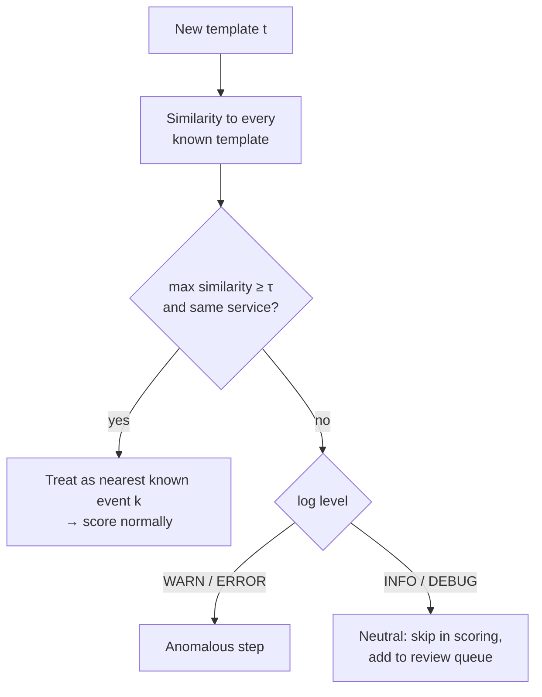

# Our Improvements

Related: [[00 - Project Hub]] · [[05 - Models]] · [[14 - Metrics and Baselines]] · [[07 - Evaluation Plan]]

Reimplementing DeepLog is not a contribution. These are the changes **we** make on top of the standard method, each with one quantitative metric we try to improve over the conventional approach, a fair experiment, and a fallback if it doesn't work.

## Table of Contents

- [[#Summary|Summary]]
- [[#Improvement 1 — Semantic template matcher|Improvement 1 — Semantic template matcher]]
- [[#Improvement 2 — Adaptive top-p detection|Improvement 2 — Adaptive top-p detection]]
- [[#Improvement 3 — Step-wise online scoring|Improvement 3 — Step-wise online scoring]]
- [[#Optional improvement 4 — Service-aware events|Optional improvement 4 — Service-aware events]]
- [[#Result tables|Result tables]]
- [[#Ablation plan|Ablation plan]]
- [[#How to talk about it|How to talk about it]]
- [[#Checklist|Checklist]]

## Summary

| # | Improvement | Conventional approach | Metric we improve | Main dataset |
|---|---|---|---|---|
| 1 | **Semantic template matcher** (signature contribution) | Vanilla DeepLog flags every unseen template as anomalous | **False alarms/h after a deployment** ↓ while keeping recall | Demo app F7 deploy; BGL later period |
| 2 | **Adaptive top-p detection** | Fixed top-g (g = 9) acceptance set | **F1 / precision** ↑ under chronological split | BGL, HDFS |
| 3 | **Step-wise online scoring** | Score a session after it closes; threshold alerts on 60 s windows | **Mean time to detect** ↓ | Demo app F1–F6 |
| 4 | Service-aware events (optional) | Event ID only | Recall on cross-service faults ↑ | Demo app |

Improvement 1 is the one to headline — one clear number, easy to show live, rooted in a known research problem.

## Improvement 1 — Semantic template matcher

### The problem

Software changes its log messages constantly. The ICSE 2022 study *"Log-based Anomaly Detection with Deep Learning: How Far Are We?"* lists **unstable logs** as a major cause of false alarms, citing that 30.3% of logs changed in a later version of Microsoft's systems. Vanilla DeepLog maps every template it never saw in training to "unknown" and flags the session — so a harmless redeploy that rewords `Payment confirmed for order <*>` to `Payment successfully confirmed for order <*>` fires an alert on **every request**.

### The idea

When Drain produces a template not in the training vocabulary, try to map it to the closest known template before deciding it's anomalous:



### Similarity function

Start simple; upgrade only if needed.

1. **Token Jaccard** on non-wildcard tokens (lower-cased):
   `J(t, k) = |tokens(t) ∩ tokens(k)| / |tokens(t) ∪ tokens(k)|`
2. **TF-IDF cosine** over template words (IDF from training templates) — rare words like `confirmed` count more than `for`, `order`.
3. *(stretch)* **Sentence embeddings** (e.g. a small sentence-transformers model) — catches synonyms (`completed` ↔ `finished`).

Use the same service as a hard constraint (a payment template can only map to a payment template), and require the same log level class (INFO-ish vs ERROR-ish) so an ERROR message never gets mapped to a normal INFO event.

### Worked example

Known templates (payment service): `E4 Payment confirmed for order <*>`, `E3 Charging card for order <*> amount <*>`, `E6 Gateway timeout after <*> ms`.

New template after deploy: `Payment successfully confirmed for order <*>` (INFO).

Token sets (wildcards dropped):
- new: {payment, successfully, confirmed, for, order}
- E4: {payment, confirmed, for, order}
- E3: {charging, card, for, order, amount}

Jaccard with E4 = 4 / 5 = **0.80**; with E3 = 2 / 8 = 0.25. With τ = 0.6 → mapped to **E4** → the request is scored as normal. A genuinely new `Ledger write failed code <*>` (ERROR) has max similarity ≈ 0.1 → stays unmatched → anomalous step. That's the behaviour we want.

### Code sketch

`src/logpulse/models/template_matcher.py`:

```python
from sklearn.feature_extraction.text import TfidfVectorizer
from sklearn.metrics.pairwise import cosine_similarity
import re

def clean(t):  # drop wildcards and masks, lowercase
    return re.sub(r"<[^>]+>", " ", t).lower()

class TemplateMatcher:
    def __init__(self, known, tau=0.6):
        # known: dict event_id -> (template, service, level_class)
        self.ids = list(known)
        self.meta = known
        self.vec = TfidfVectorizer(token_pattern=r"[a-z]+")
        self.K = self.vec.fit_transform([clean(known[i][0]) for i in self.ids])
        self.tau = tau

    def match(self, template, service, level_class):
        sims = cosine_similarity(self.vec.transform([clean(template)]), self.K)[0]
        best, best_s = None, 0.0
        for idx, s in enumerate(sims):
            eid = self.ids[idx]
            _, svc, lvl = self.meta[eid]
            if svc == service and lvl == level_class and s > best_s:
                best, best_s = eid, s
        return (best, best_s) if best_s >= self.tau else (None, best_s)
```

Detector policy:

```python
if event_id not in vocab:
    mapped, score = matcher.match(template, service, level_class)
    if mapped is not None:
        event_id = mapped                         # score normally
    elif level_class == "error":
        return anomaly(step, reason="unseen error template")
    else:
        review_queue.add(template); continue      # neutral step
```

### Experiment (E10)

- **Demo app deploy (F7):** build a `payment:v2` image where 30% of payment's log messages are reworded (wording only — same behaviour), plus one genuinely new ERROR message that fires only under a real fault. Run 30 min of normal traffic + scheduled real faults (F1, F3, F4) after the deploy. 5 runs.
- **BGL:** chronological split; templates appearing only in the test period are "unseen" naturally (Drain fitted on train, `match()` on test).
- **Compare 4 policies:** (P1) vanilla — unseen = anomaly; (P2) ignore unseen; (P3) severity-only (unseen ERROR = anomaly, unseen INFO = ignore); (P4) **ours** — matcher + severity fallback.
- **Tune τ** ∈ {0.4, 0.5, 0.6, 0.7, 0.8} on run 1 / BGL validation; report on the rest.

**Metrics:** false alarms/h in the 30 min after deploy (primary), recall on the real faults during that period, F1 on BGL test, % of unseen templates correctly mapped (hand-check the mapping table — it's small).

**Headline sentence to aim for:** *"After a deployment that reworded 30% of the payment service's log messages, the semantic template matcher reduced false alarms from A/h (vanilla DeepLog) to B/h (−X%) while recall on real faults stayed within Y points."*

**Fallback if it doesn't help:** report P3 vs P4 honestly; analyse which rewordings the matcher missed (synonyms → motivates embeddings as future work).

## Improvement 2 — Adaptive top-p detection

### The problem

DeepLog accepts the actual next event if it is in the model's **top g** predictions (g = 9 in the paper). A fixed g is crude:
- After *"Charging card"*, essentially only two events are plausible — g = 9 lets 7 implausible events slip through → missed anomalies.
- After a branchy step with 12 normal continuations, g = 9 rejects normal behaviour → false alarms.

### The idea

Accept the actual event if it lies in the **smallest set of predictions whose probabilities sum to ≥ p** (nucleus / top-p). The allowed set shrinks when the model is confident and grows when it isn't.

```python
probs = torch.softmax(logits, dim=-1)            # shape [n_events]
sorted_p, order = probs.sort(descending=True)
k = int((sorted_p.cumsum(0) < p).sum()) + 1      # smallest set reaching mass p
allowed = order[:k]
is_anomalous_step = actual not in allowed
```

### Worked example

At step 4 of a checkout trace the model predicts: E4 0.71, E7 0.22, E5 0.03, E6 0.003, others tiny.

- **Fixed top-9:** allowed = 9 events, which includes E6 → the timeout is accepted → **missed**.
- **Top-p, p = 0.95:** cumulative 0.71 → 0.93 → 0.96 → allowed = {E4, E7, E5} → E6 rejected → **caught**.

At a branchy step with 12 near-equal options (each ≈ 0.08), top-9 rejects 3 normal options, top-p 0.95 accepts all 12 → **no false alarm**.

### Experiment (E11)

- HDFS and BGL, chronological split, same trained LSTM for both rules (only the decision rule changes — clean comparison).
- Sweep g ∈ {1 … 15} for top-g and p ∈ {0.80, 0.90, 0.95, 0.99, 0.995, 0.999} for top-p; pick each method's best on validation; compare once on test.
- 5 seeds. Report P, R, F1, and the full curves (F1 vs g, F1 vs p).
- Also on demo-app traces.

**Headline sentence to aim for:** *"Adaptive top-p raised DeepLog's F1 on BGL (chronological split) from A to B over fixed top-g, mainly by improving precision/recall at low-branching steps."*

**Why BGL:** the ICSE 2022 study reported DeepLog at 0.426 F1 on BGL under chronological split — the most room to improve. On HDFS everything is near the ceiling; expect little change there and say so.

**Variant if time allows:** a per-step **surprise threshold**: anomalous if `−log p(actual) > θ`, θ tuned on validation. Compare all three rules.

## Improvement 3 — Step-wise online scoring

### The problem

Two conventional delays:
- Offline DeepLog setups score a session after it's complete.
- Threshold alerting (B2) must wait for a 60 s window to accumulate errors.

### The idea

Score each event **the moment it arrives**, using the trace's events so far as the LSTM input window. Alert on the first anomalous step; don't wait for the session to close. Keep the LSTM hidden state per open trace (or just recompute on the last `h` events — cheap for a small model).

### Experiment (E12)

On demo-app faults F1–F6, 10 runs each: compare TTD for (a) session-close scoring, (b) step-wise scoring, (c) B1 keyword, (d) B2 error-rate threshold, (e) B3 health check.

**Metric:** median TTD (IQR), plus detection rate.

**Headline sentence:** *"Step-wise scoring detected faults a median of A s after onset, versus B s for a 60-second error-rate threshold and C s for session-level scoring."*

## Optional improvement 4 — Service-aware events

Combine `(service, event_id)` into the token the LSTM sees, or add a service embedding next to the event embedding. Helps when the same template text is logged by multiple services, and when a fault shows up as a call to the wrong service. Metric: recall on F3/F6. Only attempt after 1–3 are done.

## Result tables

**Table D1 — Unseen-template policies (E10)**

| Policy | FA/h after deploy | Recall on real faults | BGL F1 (chrono) | Unseen templates mapped correctly |
|---|---|---|---|---|
| P1 vanilla (unseen = anomaly) | | | | — |
| P2 ignore unseen | | | | — |
| P3 severity only | | | | — |
| **P4 semantic matcher (ours)** | | | | |

**Table D2 — Decision rule (E11)**

| Rule | Best param (val) | HDFS P / R / F1 | BGL P / R / F1 | Demo P / R / F1 |
|---|---|---|---|---|
| Fixed top-g | g = | | | |
| **Adaptive top-p (ours)** | p = | | | |
| Surprise threshold (variant) | θ = | | | |

**Table D3 — Detection latency (E12)**

| Method | Median TTD (s) | IQR | Detection rate |
|---|---|---|---|
| B1 keyword | | | |
| B2 error-rate 60 s | | | |
| B3 health check | | | |
| DeepLog session-close | | | |
| **DeepLog step-wise (ours)** | | | |

## Ablation plan

Turn improvements on one at a time to show each one's own effect:

| Config | Matcher | Top-p | Step-wise | Purpose |
|---|---|---|---|---|
| Vanilla DeepLog | ✘ | ✘ | ✘ | Baseline |
| + matcher | ✔ | ✘ | ✘ | Effect of 1 |
| + top-p | ✘ | ✔ | ✘ | Effect of 2 |
| + both | ✔ | ✔ | ✘ | Interaction |
| **Full (ours)** | ✔ | ✔ | ✔ | Final system |

Report FA/h after deploy, F1 (BGL, demo), and TTD for every row.

## How to talk about it

- **Synopsis / report "Novelty" paragraph:** "Beyond reproducing DeepLog, we propose and evaluate three modifications targeting known weaknesses: a semantic template matcher for unstable logs, an adaptive top-p acceptance rule, and step-wise online scoring. Each is evaluated against the conventional approach under a chronological split and in live fault-injection runs."
- **Viva:** "Vanilla DeepLog treats a reworded log message as an anomaly. We map new templates to the closest known one within the same service and log level; only unmatched errors raise alerts. It's measured by false alarms after a deploy — here's the before and after."
- **Never** state target numbers as achieved; fill [[#Result tables|the tables]] first.

## Checklist

- [ ] Implement `TemplateMatcher` (TF-IDF cosine) + detector policy P1–P4
- [ ] Build `payment:v2` image with 30% reworded messages + one new ERROR message
- [ ] Run E10 (demo deploy × 5, BGL), tune τ on validation
- [ ] Implement top-p and surprise-threshold decision rules (same trained model)
- [ ] Run E11 sweeps on HDFS, BGL, demo; 5 seeds
- [ ] Implement step-wise scoring in the online detector; run E12
- [ ] Ablation table
- [ ] Hand-check the matcher's mapping table; report mapping accuracy
- [ ] Write Novelty paragraph + figures (deploy alert-rate chart, F1 vs g/p curves, TTD timeline)
