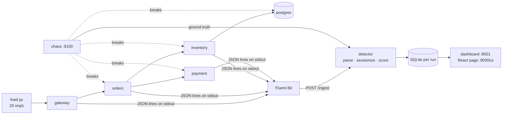

# What Does What

Related: [[02 - System Architecture]] · [[16 - Fault Catalogue Explained]] · [[17 - How to Run]]

A map of the built system: which container does what, how one log line travels to an alert, and what every file in the repo is for. Use it to find where to look when something needs changing.

## Table of Contents

- [[#The big picture in one paragraph|The big picture in one paragraph]]
- [[#Containers|Containers]]
- [[#The life of one log line|The life of one log line]]
- [[#The nine detectors|The nine detectors]]
- [[#Our three improvements — where they live|Our three improvements — where they live]]
- [[#Repository map|Repository map]]
- [[#Where data and outputs go|Where data and outputs go]]
- [[#Who to ask about what (team split)|Who to ask about what]]

## The big picture in one paragraph

Four small web services (gateway → orders → inventory / payment, plus Postgres) handle fake checkouts sent by a load generator. Every service prints one JSON log line per step with a shared `trace_id`. Docker hands those lines to **Fluent Bit**, which posts them to the **detector**. The detector turns each line into an event ID with **Drain3**, groups events per request (trace), and checks each step with a **DeepLog LSTM** trained on healthy traffic, alongside conventional alerts (keyword, error rate, health check). Alerts go into a per-run **SQLite** database, which the **dashboard** reads. A **chaos** service breaks things on purpose and writes down exactly when (ground truth), so every alert can be marked right or wrong. Separately, an **offline track** runs the same parsing and models on the public HDFS and BGL datasets for the research tables.

## Containers

`deploy/docker-compose.yml`, project name `logpulse`:

| Container | Image built from | Port | Job |
|---|---|---|---|
| `gateway` | `services/gateway/` | 8000 | Entry point. Creates the `trace_id`, checks auth, forwards to orders, logs the final status (the trace's last line) |
| `orders` | `services/orders/` | — | Creates the order, calls inventory (reserve), calls payment (charge, up to 4 tries), releases stock on failure |
| `inventory` | `services/inventory/` | — | Reserves / releases stock in Postgres |
| `payment` | `services/payment/` (`LOG_VARIANT=v1`) | — | Charges the card; can decline (normal) or be busy (normal, rarely) |
| `payment-v2` | same Dockerfile, `LOG_VARIANT=v2` | — | The F7 "bad deploy": same behaviour, two reworded messages. Created stopped; chaos swaps it in |
| `db` | `postgres:16` | — | Stock table |
| `fluent-bit` | `fluent/fluent-bit:3.1` + `deploy/fluent-bit.conf` | 24224 | Receives container logs (Docker fluentd driver), parses the JSON, posts batches to the detector, and keeps a copy in `data/demo/fluentbit/` (our published dataset) |
| `detector` | `deploy/detector.Dockerfile` (code from `src/`, mounted) | 9000 | The whole online pipeline + the dashboard's API + the React page |
| `chaos` | `deploy/chaos.Dockerfile` (`chaos/inject.py`) | 9100 | Applies / restores faults F1–F7 through the Docker socket and the services' `/admin/fault` switch; records ground truth |
| `dashboard` | `deploy/dashboard.Dockerfile` (`dashboard/app.py`, mounted) | 8501 | Streamlit UI; talks only to the detector API |

Every service also has `GET /health` (used by the health-check baseline) and `POST /admin/fault` (the runtime fault switch, which never logs).

## The life of one log line

Example: orders prints `Calling payment to charge order 52811 amount 998.00` for trace `a91f3c…`.

| # | Step | Where in code | What happens |
|---|---|---|---|
| 1 | **Emit** | `services/common/logging_setup.py` | The JSON formatter writes `{"ts","level","service","trace_id","msg"}` to stdout; the trace ID comes from the `X-Trace-Id` header via middleware |
| 2 | **Ship** | `deploy/fluent-bit.conf` | Docker's fluentd driver → Fluent Bit → JSON fields lifted → `POST /ingest` (batches every 1 s) |
| 3 | **Receive** | `online/ingest_api.py` → `Pipeline.submit` | The batch is queued; a background loop runs `Pipeline.tick()` every 0.25 s |
| 4 | **Store raw** | `online/detector.py` `_ingest` | Row in `raw_lines` (container, per-container line number, level, trace, msg) |
| 5 | **Parse** | `online/parser.py` | Masks numbers/IPs/…, runs Drain3 from the frozen training tree → `event_id = 10`, template `Calling payment to charge order <NUM> amount <NUM>`. An ID beyond the training vocabulary = **unseen** template |
| 6 | **Match (if unseen)** | `models/template_matcher.py` | New template → nearest known template of the same service and severity (TF-IDF cosine ≥ τ) → `new-matched` or `new-unmatched`; row in `templates` |
| 7 | **Conventional checks** | `detector.py` `_b1`, `_b2` | Keyword regex (B1); if it's a gateway response line, the error-rate window (B2) |
| 8 | **Buffer** | `online/sessionizer.py` | Waits 2 s (lines from different containers arrive out of order), then releases events in timestamp order into the trace's sequence |
| 9 | **Score step-wise (ours)** | `detector.py` `_score_steps` | LSTM gets the trace's last 10 events → probability of every next event → anomalous if the observed event is outside the top-p set (or is an unmatched unseen ERROR). Every step is stored in `decisions` (top-5 predictions, p of actual, set size) |
| 10 | **Close trace** | `sessionizer.py` `due` | On the gateway's `Response sent…` line, or after 5 s idle → row in `sessions` |
| 11 | **Score at close** | `detector.py` `_close` | Vanilla DeepLog, the ablation variants and Random Forest score the whole trace |
| 12 | **Alert** | `detector.py` `_alert` | One alert per detector per trace, with expected top-5, observed event, probability, reason, raw line reference, model and template versions |
| 13 | **Verdict** | `eval/live.py` | Alert vs ground truth → TRUE POSITIVE / FALSE POSITIVE; time to detect; false alarms per hour |
| 14 | **Show** | `dashboard/app.py`, `dashboard/react/index.html` | Panels read `/api/*`; any alert → raw lines → model decision → verdict |

## The nine detectors

All run at the same time on the same stream (fair comparison). Names match the `detector` column in the `alerts` table.

| Detector | What it is | When it decides | Unseen templates | Decision rule |
|---|---|---|---|---|
| `B1_keyword` | `grep`-style alerting | per line | — | line matches `ERROR\|Exception\|Traceback\|timeout\|failed`; max 1 alert per service per 10 s |
| `B2_error_rate` | Prometheus-style threshold | per gateway response | — | > 10% non-2xx responses in the last 60 s (at least 20 requests); max 1 per 60 s |
| `B3_health` | Liveness probe | every 10 s | — | `/health` fails 3 times in a row |
| `rf` | Random Forest on event counts | trace close | count as UNSEEN | trained on labelled tuning-run traces |
| `deeplog_vanilla` | DeepLog as in the paper | trace close | **anomaly** (P1) | actual event not in top-9 |
| `deeplog_matcher` | + improvement 1 | trace close | matcher (P4) | top-9 |
| `deeplog_topp` | + improvement 2 | trace close | anomaly (P1) | top-p (p = 0.999) |
| `deeplog_both` | + 1 + 2 | trace close | matcher (P4) | top-p |
| `deeplog_full` | **ours: + 1 + 2 + 3** | **every event** (step-wise) | matcher (P4) | top-p |

The four middle DeepLog variants exist for the ablation study; the dashboard focuses on `B1`, `B2`, `B3`, vanilla and `deeplog_full`.

## Our three improvements — where they live

| Improvement | Problem it fixes | Code | Shown by |
|---|---|---|---|
| 1. Semantic template matcher | A harmless redeploy rewords log messages → vanilla DeepLog alerts on every request | `models/template_matcher.py`; used in `online/detector.py` `_match` / `_tok_p4`; offline BGL experiment in `eval/experiments.py` `e10_bgl` | F7 in the demo (vanilla 1,664 alerts vs ours 46); BGL F1 0.19 (vanilla) → 0.73 (matcher + top-p) |
| 2. Adaptive top-p | Fixed top-g accepts implausible events after confident steps and rejects normal ones after branchy steps | `models/deeplog.py` `StepStats.steps_topp`, `allowed_set` | Table D2 (E11); `deeplog_topp` in the ablation |
| 3. Step-wise scoring | Session-close scoring waits for the request to finish; error-rate waits for a 60 s window | `online/detector.py` `_score_steps` | F1 in the demo: ours 4.5 s vs vanilla 10.1 s vs error-rate 12.3 s |

## Repository map

### `src/logpulse/` — the Python package (all logic lives here)

| File | What it does |
|---|---|
| `paths.py` | All folder paths; event-ID convention (0 = PAD, 1 = UNSEEN, templates from 2; novel test templates ≥ 1,000,000) |
| `store.py` | SQLite schema for a run: `raw_lines`, `events`, `templates`, `sessions`, `decisions`, `alerts` (+ `baseline_alerts` view), `ground_truth`, `feedback`, `run_info` |
| **parsing/** `drain_parser.py` | Drain3 setup with masks (`configs/drain3.ini`), cached mining, grouping-accuracy metric, full HDFS/BGL parsers producing the *full* and *honest* (fit-on-train) parses, 3-level severity classes |
| **features/** `sessionize.py` | `SessionSet` container; HDFS block sessions; trace sessions |
| **features/** `windows.py` | BGL fixed windows (20/100 lines) and sliding time windows |
| **features/** `vectorize.py` | Event-count matrices + TF-IDF / binary / +length variants for classical models |
| **models/** `baselines.py` | LR, DT, NB, RF; PCA (residual SPE) and Isolation Forest detectors |
| **models/** `deeplog.py` | The LSTM, windowing, de-duplicated weighted training, batched scoring (`StepStats` with rank / mass-before / log-p), rules top-g / top-p / surprise |
| **models/** `template_matcher.py` | Improvement 1 + the unseen-template policies P1–P4 |
| **online/** `ingest_api.py` | FastAPI app on :9000: `/ingest`, all `/api/*` endpoints, run reset/export, fault proxy, `/ui` |
| **online/** `detector.py` | `Pipeline`: the whole online flow from the table above + B1/B2/B3 + all model detectors |
| **online/** `parser.py` | Online Drain3 (frozen training tree that keeps learning; flags unseen IDs) |
| **online/** `sessionizer.py` | Reorder buffer, trace open/close, late-event re-open |
| **online/** `train_demo.py` | Builds `artifacts/demo/` from a recorded normal run (GA sweep → sim_th 0.85, Drain tree, DeepLog, flow graph) |
| **online/** `tune_demo.py` | Tunes g / p / θ / τ / B1 / B2 and trains RF on tuning runs (pending a fix) |
| **online/** `replay.py` | Re-parses a recorded run offline exactly like the live parser (for training, tuning, scoring) |
| **online/** `demo_templates.py` | The true template of every demo log statement (GA ground truth; checks matcher mappings) |
| **eval/** `splits.py` | Chronological and random splits |
| **eval/** `metrics.py` | P/R/F1, PR-AUC, threshold search, `write_results` (locked writes to `reports/results.csv`) |
| **eval/** `experiments.py` | Offline experiments E1, E2, E2b, E3, E4, E5, E5b, E7, E10 (BGL), E11 |
| **eval/** `live.py` | Live scoring rules: alert → fault mapping, detection table, TTD, false alarms, trace labels, lines to read, scoreboard |
| **eval/** `score_live.py` | Scores all test runs → live tables (A, B, D1, D3, E, ablation) |
| **eval/** `tables.py` | Builds every report table from `results.csv` → `reports/tables.md` |
| **eval/** `figures.py`, `plots.py` | Report figures and their shared style |
| **eval/** `incidents.py` | Markdown incident report per fault + run summary |
| **eval/** `facts.py` | Headline sentences with numbers pulled from `results.csv` (abstract) |

### Everything else

| Path | What it does |
|---|---|
| `services/common/logging_setup.py` | JSON logging, trace-ID middleware, `/health`, `/admin/fault` — shared by all services |
| `services/{gateway,orders,inventory,payment}/app.py` + `Dockerfile` | The demo microservices (fault modes are in orders and payment) |
| `deploy/docker-compose.yml` | The whole stack; `payment-v2` under the `deploy` profile; named volume `runs` |
| `deploy/fluent-bit.conf` | Log shipping: forward input → JSON parser → HTTP to detector + file copy |
| `deploy/*.Dockerfile` | Images for detector, chaos, dashboard |
| `chaos/inject.py` | Fault injector API (F1–F7) + ground-truth recording |
| `chaos/schedule.py` | Seeded random fault schedules for the measurement protocol |
| `chaos/ground_truth.csv` | Every fault ever injected (appended automatically) |
| `dashboard/app.py` | Streamlit dashboard (Live, Investigate, Flow graph, Templates, Incidents, Benchmarks) |
| `dashboard/react/index.html` | React Flow page (topology, flow graph with trace overlay, lanes) served at `:9000/ui` |
| `scripts/demo.py` | One-command demo: F1 → F3 → F7, then scoring and incident reports |
| `scripts/demo_summary.py` | Prints the per-fault detection table and F7 alert counts for one run |
| `scripts/load.py` | Load generator (Poisson arrivals, seeded) |
| `scripts/run_live_protocol.py` | Records the normal / tuning / test runs of the measurement protocol |
| `scripts/score_live.py` | Wrapper for `eval/score_live.py` |
| `scripts/run_all_experiments.py` | Runs the offline experiments from `configs/experiments.yaml` + figures |
| `scripts/download_data.py` (`.sh`) | Downloads HDFS_v1, BGL and Loghub-2k; writes checksums to `data/README.md` |
| `scripts/incident_report.py` | Writes incident reports for a run |
| `scripts/screenshot_dashboard.py` | Playwright screenshots of the dashboard tabs |
| `scripts/make_report.py` + `scripts/report/build_docx.js` | Word report from `results.csv`, tables and figures |
| `scripts/user_study/` | Kit for the time-to-root-cause study (Table F) |
| `configs/drain3.ini` | Drain masks and default threshold |
| `configs/experiments.yaml`, `configs/deeplog.yaml` | Seeds, grids and model settings for the offline experiments |
| `notebooks/01–04` | EDA, parsing, baselines, DeepLog — they only call `src/` functions |
| `tests/` | 15 unit tests (parser, sessionizer and scoring rules, DeepLog and matcher) |
| `Makefile` | Shortcuts (`make demo`, `make results`, …) for machines with `make` |

## Where data and outputs go

| Path | Contents | In git? |
|---|---|---|
| `data/raw/` | Downloaded HDFS / BGL / Loghub-2k | no |
| `data/processed/{hdfs,bgl}/` | Parsed sessions / lines, templates, `meta.json` | no |
| `data/demo/runs/<run>.db` | Exported SQLite of each live run (+ `_stats.csv`, `_load.log`) | no |
| `data/demo/fluentbit/` | Raw shipped log files (the demo dataset) | no |
| `artifacts/demo/` | Live model: `drain_state.bin`, `template_map.json`, `deeplog.pt`, `rf.pkl`, `transitions.json`, `config.json` | no |
| `artifacts/benchmarks/` | DeepLog models for HDFS / BGL experiments | no |
| `reports/results.csv` | **Every reported number** (one row per experiment × dataset × model × seed / metric) | yes |
| `reports/tables.md`, `reports/figures/` | Generated tables and figures | yes |
| `reports/incidents/` | Generated incident reports | no (regenerate) |
| Docker volume `logpulse_runs` | Live (in-progress) run DBs inside the detector | — |

## Who to ask about what

Using the four tracks from [[09 - Roadmap and Team Split]]:

| Track | Owns these parts of the repo |
|---|---|
| A — Parsing & data | `parsing/`, `features/`, `scripts/download_data.py`, `configs/drain3.ini`, E1 |
| B — Models & evaluation | `models/`, `eval/experiments.py`, `eval/tables.py`, `eval/figures.py`, E2–E11 |
| C — Microservices & chaos | `services/`, `deploy/`, `chaos/`, `scripts/load.py`, `scripts/run_live_protocol.py` |
| D — Online pipeline & UI | `online/`, `store.py`, `eval/live.py`, `eval/score_live.py`, `eval/incidents.py`, `dashboard/` |
